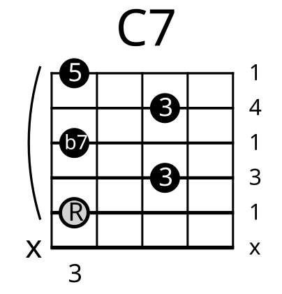
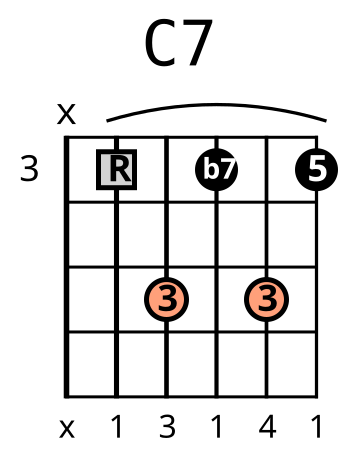
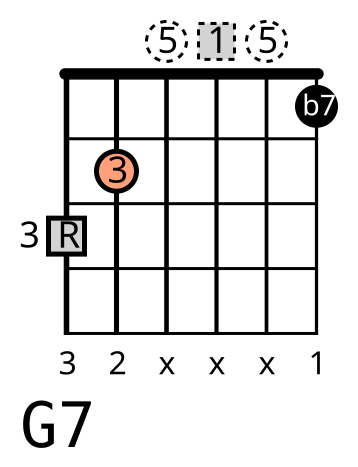

**FancyChords** and **FancyScales** are program for guitar players who are also command line *enthusiast*. 

FancyChords can draw nice looking (fancy) chords and FancyScales do the same for scales diagrams.

Assuming you are familiar with guitar tab notation, take for example C Major chord.

We can write its properties (from 6th string to 1st string)

- frets:  x,3,2,0,1,0

- fingers: x,3,2,x,1,x

- intervals: x,R,3,5,R,3

Here is the simplest example for using fancychords via command line:

` fancychords --cli_in="C Major|x,3,2,0,1,0"`

By doing that you get a file called "C Major.svg" that looks like that

Going deep in the command line we have

`--cli_in` is a parameter that tells fancychords to get chord properties from command line (the other possibility is by using a text file using `--file_in`).

Chord properties is a string in the form of 

> "chord_name|frets|fingers|intervals|labels|footer|subfolder".

where 

- chord_name: image chord name, this will also be used as file name. If dots are present in chord_name only the rightest dot will be used in file name.  So "C Major. 2nd  Inversion.v01" will output a chord whose label will be "C Major. 2nd Inversion" and whose file name will be "C Major. 2nd Inversion.v01.svg"

- frets: frets sequence list separated by commas

- fingers: finger numbers list separated by commas

- intervals: interval sequence list separated by commas

- labels: dot labels sequence list separated by commas. Default to fingers if present else default to intervals if present. If both are present it default to fingers.

- footer: footer sequence list separated by commas

- subfolder: output folder for chord image, default to "./"

Only chord_name and frets are mandatory, other can be skipped by a "%".

Now let's add some stuff like fingers, intervals. We also want to highlight the root note, `--root-diff` and display a footer, `--footer`. We won't supply labels list (`%`) so, by default, fingers will be displayed in the dots.

Command line is now:

`fancychords --cli_in="C Major.v02|x,3,2,0,1,0|x,3,2,x,1,x|x,R,3,5,R,3|%|x,R,3,5,R,3" --root-diff --footer`

and "C Major.v02.svg" file looks like that

But what about barre chords? Let's try with C7 chord. 

- frets:  x,3,5,3,5,3

- fingers: x,1,3,1,4,1

- intervals: x,R,3,b7,3,5

Using fingers and frets combination, fancychords by default draw a barre if needed (use `--no-barre` to disable)  

This time we also want the chord to be horizontal (`--horizontal`) and we want display intervals in the dots and fingers in the footer.

Command line is now:

`fancychords --cli_in="C7|x,3,5,3,5,3|x,1,3,1,4,1|x,R,3,b7,3,5|x,R,3,b7,3,5|x,1,3,1,4,1" --horizontal --root-diff --footer`

More fancier looking chords can be drawn using a config file:

`fancychords --cli_in="C7.v02|x,3,5,3,5,3|x,1,3,1,4,1|x,R,3,b7,3,5|x,R,3,b7,3,5|x,1,3,1,4,1" --config_file="./config_v01.json"`

[config_v01.json](./assets/config_v01.json) is a json file with all possible options available. More informations on json config file are here (TODO).

Below another complex example:

`fancychords --cli_in="G7|3,2,0,0,0,1|3,2,x,x,x,1|R,3,5,R,5,b7|R,3,5,1,5,b7|3,2,x,x,x,1" --config_file="./config_v02.json"`

with [config_v02.json](./assets/config_v02.json)
