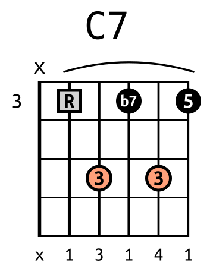
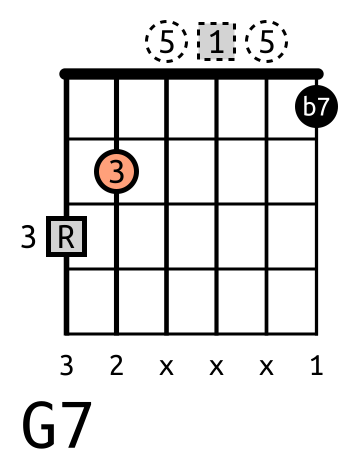
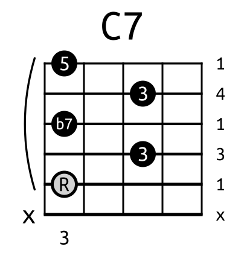
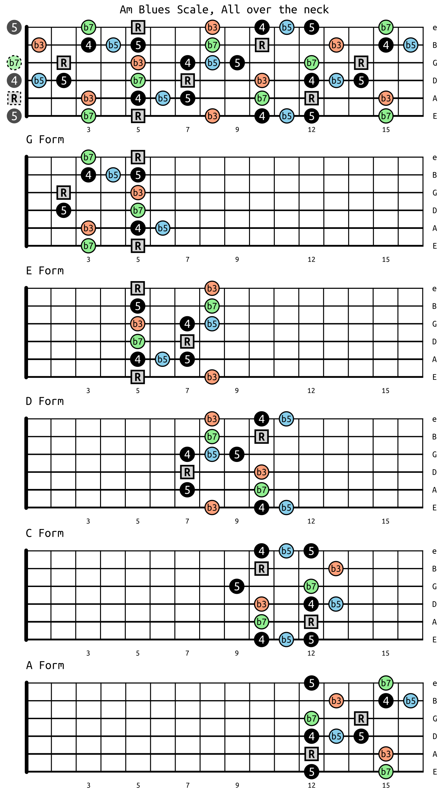

# FancyChords & FancyScales

**FancyChords** and **FancyScales** are programs for guitar players who are also command line *enthusiasts*.

- **FancyChords** draws nice looking (fancy) chord diagrams.
- **FancyScales** does the same for scale diagrams.

Both write **SVG** images (and optionally **PNG**), can build an **HTML gallery** of everything they drew, and can be styled in detail with a **JSON config file**.

<p>




</p>

## Contents

- [Features](#features)
- [Installation](#installation)
  - [Required font: Ubuntu Mono derivative FChords](#required-font-ubuntu-mono-derivative-fchords)
- [FancyChords tutorial](#fancychords-tutorial)
- [Chord notation reference](#chord-notation-reference)
- [Chord list files](#chord-list-files)
- [FancyChords options](#fancychords-options)
- [Config file](#config-file)
- [PNG images and HTML report](#png-images-and-html-report)
- [FancyScales](#fancyscales)
  - [Example: the A minor blues scale in CAGED forms](#example-the-a-minor-blues-scale-in-caged-forms)
- [Errors and exit status](#errors-and-exit-status)
- [Building standalone executables](#building-standalone-executables)
- [Project layout](#project-layout)
- [Running the tests](#running-the-tests)
- [License](#license)

## Features

- Chords from the command line or from a text file (one chord per line, hundreds at once)
- Fingers, intervals, custom dot labels and a footer line under the fretboard
- Barres drawn automatically from the fingering
- Fret number on the side for chords up the neck, nut drawn for open position chords
- Optional dots above the nut for open strings
- Vertical or horizontal diagrams
- Different look for the root note, or for any interval you like (colors, squares, dashed "ghost" notes...)
- English (`C`, `F#`, `Bb`) and Latin (`DO`, `FA#`, `SIb`) chord names
- Output organized in subfolders, duplicate names never overwrite each other
- PNG conversion and HTML gallery report
- Scales over any range of frets, with arrows between notes

## Installation

> **No Python?** Ready-to-run executables for Linux and Windows are available too: see [Building standalone executables](#building-standalone-executables) below, or download them from the [Releases](https://github.com/simonefelli/fancychords/releases) page: each archive also has the font, examples and a README.txt with the install steps.

You need **Python 3** and two Python libraries:

```bash
pip install svgwrite cairosvg
```

- [svgwrite](https://pypi.org/project/svgwrite/) draws the SVG images.
- [CairoSVG](https://cairosvg.org/) converts them to PNG. It needs the Cairo graphics library on your system (on Linux it is usually already installed; on Windows and macOS see the [CairoSVG documentation](https://cairosvg.org/documentation/)).

Then get the code:

```bash
git clone https://github.com/simonefelli/fancychords.git
cd fancychords
python3 fancychords.py --help
python3 fancyscales.py --help
```

### Required font: Ubuntu Mono derivative FChords

The diagrams are drawn by default with **`Ubuntu Mono derivative FChords`**: the Ubuntu Mono font of
the ubuntu-font-family **0.83** release with its own name. **Install it before using the programs**
(Python scripts or executables): the four `.ttf` files in
[fonts/ubuntu-mono-derivative-fchords](./fonts/ubuntu-mono-derivative-fchords), installed like any
other font on Linux or Windows. Nothing else is needed. An SVG only stores the font *name*, so
the font must be installed on the computer that shows or converts the image; without it another
font is used and the labels look different.

It is the older Ubuntu Mono on purpose: the newer Ubuntu Mono of recent systems (ie Ubuntu 24.04)
draws bolder and larger characters. With its own name the right font is always used, also where
the newer one is installed. See [fonts](./fonts) for the install steps, the licence (Ubuntu Font
Licence 1.0) and how the font was made.

Other available fonts: `Ubuntu Mono`, `Liberation Mono`, `DejaVu Sans Mono` and `Courier New`
(option `-ff`). `Ubuntu Mono Legacy`, the font name of chords made with older versions, is still
accepted.

> In the examples below `fancychords` stands for `python3 fancychords.py` (or for the packaged executable, if you built one). The same goes for `fancyscales`.

## FancyChords tutorial

Assuming you are familiar with guitar tab notation, take for example the C Major chord. We can write its properties from the 6th string (low E) to the 1st string (high e):

- frets: `x,3,2,0,1,0`
- fingers: `x,3,2,x,1,x`
- intervals: `x,R,3,5,R,3`

Here is the simplest example for using fancychords via command line:

`fancychords --cli_in="C Major|x,3,2,0,1,0"`

By doing that you get a file called `C Major.svg` that looks like this:


`--cli_in` tells fancychords to get the chord from the command line (the other possibility is a text file, with `--file_in`, see [Chord list files](#chord-list-files)).

The chord is a string in the form of

> `chord_name|frets|fingers|intervals|labels|footer|subfolder`

Only `chord_name` and `frets` are mandatory; any other field can be skipped with `%` (all the fields are explained in the [Chord notation reference](#chord-notation-reference)).

Now let's add some stuff like fingers and intervals. We also want to highlight the root note (`--root-diff`) and display a footer (`--footer`). We won't supply the labels list (`%`) so, by default, fingers will be displayed in the dots.

`fancychords --cli_in="C Major.v02|x,3,2,0,1,0|x,3,2,x,1,x|x,R,3,5,R,3|%|x,R,3,5,R,3" --root-diff --footer`

and `C Major.v02.svg` looks like this:


Open strings can also be drawn as dots above the nut with `--nut`:

`fancychords --cli_in="C Major.v03|x,3,2,0,1,0|x,3,2,x,1,x|x,R,3,5,R,3" --nut --root-diff`


But what about barre chords? Let's try with the C7 chord:

- frets: `x,3,5,3,5,3`
- fingers: `x,1,3,1,4,1`
- intervals: `x,R,3,b7,3,5`

Using the frets and fingers combination, fancychords draws a barre when needed (use `--no-barre` to disable it). Since this chord does not start from the nut, the starting fret number is written on the side.

This time we also want the chord to be horizontal (`--horizontal`), the intervals in the dots and the fingers in the footer:

`fancychords --cli_in="C7|x,3,5,3,5,3|x,1,3,1,4,1|x,R,3,b7,3,5|x,R,3,b7,3,5|x,1,3,1,4,1" --horizontal --root-diff --footer`



Fancier looking chords can be drawn using a config file:

`fancychords --cli_in="C7.v02|x,3,5,3,5,3|x,1,3,1,4,1|x,R,3,b7,3,5|x,R,3,b7,3,5|x,1,3,1,4,1" --config_file="./config_v01.json"`


[config_v01.json](./assets/config_v01.json) uses all the available options (see [Config file](#config-file)): the root is a grey square, thirds are salmon colored, and the chord label is drawn with its own font.

Below another example, with the open strings drawn above the nut and the chord name at the bottom left:

`fancychords --cli_in="G7|3,2,0,0,0,1|3,2,x,x,x,1|R,3,5,R,5,b7|R,3,5,1,5,b7|3,2,x,x,x,1" --config_file="./config_v02.json"`


with [config_v02.json](./assets/config_v02.json).

All the example images, config files and the scale file are in the [assets](./assets) folder: run the commands from that folder to get the same images.

## Chord notation reference

| Field | Content | Example |
|---|---|---|
| `chord_name` | Chord name, drawn on top of the diagram and used as file name | `G#dim7(no5)/F#`, `LA7sus2` |
| `frets` | 6 frets, from 6th (low E) to 1st string: numbers `0`..`24`, `x` for a muted string | `x,3,2,0,1,0` |
| `fingers` | 6 fingers: `1`..`4`, `T` for the thumb, `x` for no finger | `x,3,2,x,1,x` |
| `intervals` | 6 intervals from the root, `x` for none (see the list below) | `x,R,3,5,R,3` |
| `labels` | 6 labels drawn inside the dots (short labels, 1 to 3 characters, look best) | `x,C,E,G,C,E` |
| `footer` | 6 labels drawn under the fretboard (needs `--footer`) | `x,R,3,5,R,3` |
| `subfolder` | Output subfolder, can have more levels | `C/Major` |

- Only `chord_name` and `frets` are mandatory. To skip an optional field and still give the following ones, use `%`. On the command line an empty field (`||`) works like `%` too.
- **Dot labels** default to the fingers if given, otherwise to the intervals.
- **Intervals** can be `R` (root), `b2`, `2`, `b3`, `3`, `4`, `#4`, `b5`, `5`, `#5`, `b6`, `6`, `bb7`, `b7`, `7`, `b9`, `9`, `#9`, `10`, `11`, `#11`, `12`, `b13`, `13`. Adding `h` (ie `Rh`, `b3h`) marks a note that you want to format differently, for example as a dashed "hidden" or optional note (see [Config file](#config-file)); the `h` is not shown in the labels.
- **Chord names** can use English (`C`, `F#`, `Bb`) or Latin (`DO`, `FA#`, `SIb`, upper case) note names.
- **More chords** on the command line are separated by `;`:
  `fancychords --cli_in="C|x,3,2,0,1,0;G|3,2,0,0,0,3;D|x,x,0,2,3,2"`

### File names

- The file name is the chord name. If the name has dots, the text after the **last** dot is kept in the file name but not in the label: `C Major. 2nd Inversion.v01` is drawn as "C Major. 2nd Inversion" and saved as `C Major. 2nd Inversion.v01.svg`. This is handy to have more versions of the same chord.
- `/` and `\` become `_` (`C/G` → `C_G.svg`). Characters that are not safe in file names are removed: `` ' , ; : " ? [ ] = ^ < > & $ £ * ( ) ! | ~ ` ´ { } % `` and accented or other non-ASCII characters (`G#dim7(no5)/F#` → `G#dim7no5_F#.svg`).
- When two chords would get the same file name, the second becomes `name.v02`, the third `name.v03` and so on, so no chord overwrites another. Names that differ only in upper/lower case (`Cm7`, `CM7`) count as the same name, because they are the same file on Windows and macOS.

## Chord list files

Many chords can be drawn at once from a text file with `--file_in`:

`fancychords --file_in=./my_chords.txt --output-dir=./out --root-diff`

The file has one chord per line, with the same 7 fields of the command line separated by **tabs**:

```text
// lines starting with '//' are comments, empty lines are skipped
// the first line that is not a comment is the header and is skipped too
NAME            FRETS           FINGERS         INTERVALS           LABELS      FOOTER      SUBFOLDER
C               x,3,2,0,1,0     x,3,2,x,1,x     x,R,3,5,R,3         %           %           C/Major
G#dim7(no5)/F#  2,2,0,1,0,1     3,4,x,1,x,2     b7,b3,b5,R,b3,bb7   %           %           Diminished
SI11            x,0,9,8,0,0     x,x,2,1,x,x     x,7,R,3,R,11
```

- More tabs can be used to align the columns: empty fields are ignored. For this reason, an optional field you want to skip must be written as `%`, otherwise the following fields would shift.
- The file is read as UTF-8.
- Each chord is reported as `Loaded` or `Not loaded` with the reason (ie `error in frets syntax`); chords with errors are skipped and the others are drawn.

More examples are in [tests/crds_test_files](./tests/crds_test_files).

## FancyChords options

| Option | Effect |
|---|---|
| `--cli_in "..."` | Chord(s) from the command line (this or `--file_in` is required) |
| `--file_in FILE` | Chords from a text file |
| `-o`, `--output-dir DIR` | Output folder (default `./`) |
| `-cf`, `--config_file FILE` | JSON config file |
| `-ho`, `--horizontal` | Horizontal diagram |
| `-lb`, `--label_bottom` | Chord name at the bottom |
| `-rd`, `--root-diff` | Different dots for the root note |
| `-n`, `--nut` | Draw open strings as dots above the nut |
| `-ft`, `--footer` | Draw the footer labels |
| `-nh`, `--no-header` | Do not draw `x` / `0` above the nut |
| `-ndl`, `--no-dotlabels` | Do not draw labels inside the dots |
| `-nb`, `--no-barre` | Do not draw barres |
| `-nfn`, `--no-fretnumb` | Do not draw the fret number on the side |
| `-nnl`, `--no-nut-line` | Draw the nut as a normal (thin) line |
| `-ff`, `--font-family FONT` | `Ubuntu Mono derivative FChords` (default), `Ubuntu Mono Legacy`, `Ubuntu Mono`, `Liberation Mono`, `DejaVu Sans Mono`, `Courier New` |
| `-fw`, `--font-weight W` | `normal` (default) or `bold` |
| `-c`, `--convert` | Also write PNG images |
| `-r`, `--report MODE` | HTML report: `disable` (default), `enable`, or `only` (just rebuild the report, draw nothing) |
| `-v`, `--version` | Show the version |

## Config file

A JSON config file (`--config_file`) can set every option of the command line and many more that exist only there. Every value is taken with this priority:

**command line** > **config file** > **default value**

so you can keep your favorite look in a config file and still change single options from the command line. A config file can contain only the options you want to change. It has four sections:

```json
{
  "i/o":             { "dir_output": "./" },
  "flags":           { "horiz": false, "root_is_different": true, "fret0": true, "enable_footer": true, ... },
  "generic_formats": { "font_family": "Ubuntu Mono", "chord_label_font_family": "DejaVu Sans Mono", "fretb_format": {...}, ... },
  "parameters":      { "sd": 50.0, "fd": 65.0, "lntk": 3.0, "radius_factor": 0.40, ... }
}
```

Complete examples: [assets/config_v01.json](./assets/config_v01.json) and [tests/json_cfg_tests_files/default_chords_config.json](./tests/json_cfg_tests_files/default_chords_config.json) (all the options with their default values).

### Flags and fonts

- `flags`: the same switches of the command line (`horiz`, `chord_label_isbottom`, `enable_header`, `enable_dotlabels`, `enable_footer`, `enable_barre`, `enable_fretnum`, `nutline`, `fret0`, `root_is_different`, `convert_flag`, `report`) plus `chord_label_isleft` (left aligned chord name) and `debug` (draws the construction points and boxes).
- `generic_formats`: `font_family` and `font_weight` for the whole diagram, plus a font family, weight and size factor for each kind of label: `chord_label_*`, `upper_labels_*` (the `x` / `0` above the nut), `bottom_labels_*` (footer) and `side_labels_*` (fret number). `null` means "use the global font".

### Dot formats

`fretb_format` (dots on the fretboard) and `fret0_format` (dots above the nut) decide how every dot looks. Each one is a dictionary `interval: format`, where the interval is written in lower case (`"r"`, `"b3"`, `"rh"`, ...) and `"*"` is the format for every interval without a format of its own:

```json
"fretb_format": {
  "*":   [1.0, "black",       "1.0", "black", "1.0", "none",   "3.0", "white", "1.0", "", "", false, false],
  "r":   [0.9, "lightgrey",   "1.0", "black", "1.0", "none",   "5.0", "black", "1.0", "", "", true,  false],
  "3":   [1.0, "lightsalmon", "1.0", "black", "1.0", "none",   "5.0", "black", "1.0", "", "", false, false],
  "b7h": [1.0, "white",       "1.0", "grey",  "1.0", "dashes", "3.0", "grey",  "1.0", "", "", false, false]
}
```

Every format is a list of 13 values:

| # | Value | Example |
|---|---|---|
| 0 | dot size (1.0 = normal) | `0.9` |
| 1 | dot color | `"black"`, `"#ff8800"` |
| 2 | dot opacity, `"0.0"`..`"1.0"` | `"1.0"` |
| 3 | border color | `"black"` |
| 4 | border opacity | `"1.0"` |
| 5 | border style: `"none"` (solid) or `"dashes"` | `"dashes"` |
| 6 | border width | `"3.0"` |
| 7 | label color | `"white"` |
| 8 | label opacity | `"1.0"` |
| 9 | label font weight, `""` = global font weight | `"bold"` |
| 10 | label font family, `""` = global font family | `"Ubuntu Mono"` |
| 11 | square dot instead of a circle | `true` |
| 12 | rotate the square by 45 degrees (a diamond) | `false` |

With `--root-diff` and no dot formats in the config file, the root gets a grey dot with a thicker border.

### Size parameters

`parameters` sets the geometry (every parameter is explained with a drawing in [docs/chord_geometry.md](./docs/chord_geometry.md)). The most useful ones are `sd` (distance between strings, the overall size of the image), `fd` (distance between frets), `lntk` (line thickness), `radius_factor` (dot radius = `sd * radius_factor`), `nf` (number of frets drawn, default 4; more are added when a chord needs them), `x_or` / `y_or` (margins), `barre_strk_wdth` (barre thickness), and for the HTML report `ncols` (columns of the gallery) and `thumb_width` (thumbnail width, ie `"250px"`). When `sd` and `lntk` are given, missing `fd`, `radius_factor` and `barre_strk_wdth` are computed from them, keeping the default proportions.

## PNG images and HTML report

- `--convert` writes a PNG copy of every image drawn in the run, in a `png` subfolder next to the SVG.
- `--report enable` writes an `fcreport.html` gallery in the output folder and in each subfolder (up to 4 levels deep), with links between them: open the one in the output folder with your web browser to browse all your chords. `--report only` rebuilds the gallery from the images already there, without drawing anything.

## FancyScales

FancyScales draws scale diagrams over any range of frets. It reads the scales from a text file:

`fancyscales d_form.txt --config_file=./config_scales.json`


([d_form.txt](./assets/d_form.txt), [config_scales.json](./assets/config_scales.json)): the A minor blues scale in the D form of the CAGED system, from frets 7 to 11 (see the [CAGED example](#example-the-a-minor-blues-scale-in-caged-forms) below for all the five forms).

### Scale files

A scale file is a list of blocks, one per scale. Every block has these 11 lines, always in this order, with the fields separated by tabs (lines starting with `//` are comments):

```text
NAME        D Form
FOLDER      %
FILENAME    %
STRING01    x,8,x,10,11    x,b3,x,4,b5    %
STRING02    x,8,x,10,x     x,b7,x,R,x     %
STRING03    7,8,9,x,x      4,b5,5,x,x     %
STRING04    7,x,x,10,x     R,x,x,b3,x     %
STRING05    7,x,x,10,x     5,x,x,b7,x     %
STRING06    x,8,x,10,11    x,b3,x,4,b5    %
FOOTER      E,A,D,G,B,e
ARROWS      %
```

| Line | Content |
|---|---|
| `NAME` | Scale name drawn on the diagram; `\n` splits it on two lines (ie `Am Blues Scale\nD Form`) |
| `FOLDER` | Output subfolder, `%` for none |
| `FILENAME` | File name, `%` (or empty) to use the name. If the name has dots, the text after the **first** dot goes only in the file name |
| `STRING01`..`STRING06` | For each string, from the 1st (high e) to the 6th (low E): frets, then optional intervals, then optional dot labels (ie fingers `1,x,3,4`; `%` for none: the dots show the intervals). One column per fret, `x` where there is no note; all strings must have the same number of columns |
| `FOOTER` | Up to 6 labels (max 3 characters each) drawn under the fretboard, `%` for none |
| `ARROWS` | Arrows between notes, as a tuple of `((fret, string), (fret, string))`, string 1 being the high e, ie `( ((7,4), (10,4)), ((7,3), (9,3)) )`; `%` for none. An arrow outside the drawn frets is skipped with a warning |

Scales with the same file name get `.v02`, `.v03`... like chords. More examples are in [tests/scls_tests_files](./tests/scls_tests_files).

### FancyScales options and config

FancyScales has the same options as FancyChords except `--cli_in`, `--file_in` (the scale file is the first argument) and `--no-barre`. Its config file uses the same sections (see [tests/json_cfg_tests_files/default_scales_config.json](./tests/json_cfg_tests_files/default_scales_config.json)), with `scale_label_*` instead of `chord_label_*`, and two more options:

- `arrows_format` (in `generic_formats`): `[width, color, opacity, heads, curved, style]`, where heads is `""`, `"s"` (start), `"e"` (end) or `"se"` (both), curved is `true` for a small arc, and style is `"dashes"` for a dashed arrow or `""`.
- `padding` (in `parameters`): `[from_fret, to_fret]` draws every scale on the same range of frets, handy to compare positions of a scale; `"none"` to disable.

### Example: the A minor blues scale in CAGED forms

The CAGED system splits a scale played all over the neck into five
overlapping positions, each one built around a chord shape (C, A, G, E
and D forms). FancyScales can draw both the whole neck and every single
form on the same neck, so the positions line up and are easy to compare:



The sheet is made of six diagrams drawn by two FancyScales commands (run
from the [tests/test_caged](./tests/test_caged) folder, as
[caged_scales.sh](./tests/test_caged/caged_scales.sh) does):

```bash
# the whole neck, frets 0 to 16
fancyscales ../scls_tests_files/scales-all-neck.txt --config_file=../json_cfg_tests_files/config_scales_all_neck.json --output-dir=./dirout/scales_all_neck

# the five CAGED forms, each one padded to the same frets 0 to 16
fancyscales ../scls_tests_files/caged_scales.txt --config_file=../json_cfg_tests_files/config_scales_all_neck_padded.json --output-dir=./dirout/scales_all_neck
```

- [scales-all-neck.txt](./tests/scls_tests_files/scales-all-neck.txt) has one scale block with the whole neck, and [caged_scales.txt](./tests/scls_tests_files/caged_scales.txt) has one block per form (`G Form`, `E Form`, `D Form`, `C Form`, `A Form`), each with only the frets of that position.
- The trick is `"padding": [0, 16]` in [config_scales_all_neck_padded.json](./tests/json_cfg_tests_files/config_scales_all_neck_padded.json): every form is drawn on frets 0 to 16 instead of only on its own frets, so all the diagrams have the same size and each form appears exactly where it is on the neck.
- Both configs draw horizontal diagrams with the root (`R`) as a grey square and its own color for `b3`, `b5` and `b7` (the other notes use the default black dot); the string names (`E A D G B e`) under the diagrams are the `FOOTER` line of the scale files.
- The six images were then placed on a single page with [Inkscape](https://inkscape.org/) (the font used there is Ubuntu Mono). The sheet is also available as [SVG](./tests/test_caged/blues_scale/caged_blues_complete.svg) and [PDF](./tests/test_caged/blues_scale/caged_blues_complete.pdf).

The same folder has the G major scale ([major_scale](./tests/test_caged/major_scale)) and the G minor 7 arpeggios ([arpeggios](./tests/test_caged/arpeggios)) done the same way. You do not have to write the frets of a whole-neck scale by hand: [tests/test_generate_scales/generate_scale.py](./tests/test_generate_scales/generate_scale.py) builds the scale file from a formula (ie `minor_blues_scale` in `libs/global_constants.py`) and also cuts it into CAGED forms.

## Errors and exit status

Both programs exit with status `0` on success. On errors (ie a missing input file or a broken config file) they print `fancychords error: ...` (or `fancyscales error: ...`) on stderr and exit with status `1`, so they are easy to use from scripts. A chord or a scale with a syntax error is only reported and skipped: the others are still drawn.

## Building standalone executables

FancyChords and FancyScales can be packaged with [PyInstaller](https://pyinstaller.org/) as single file executables, that run on computers without Python (the Cairo library for the PNG conversion is included too):

```bash
pip install svgwrite cairosvg pyinstaller
./packaging/build_binaries.sh          # Linux
packaging\build_binaries.bat           # Windows
```

The executables (`fancychords`, `fancyscales`, or `.exe` on Windows) are written in the `dist` folder; use them exactly like the Python scripts, ie `./dist/fancychords --cli_in="C|x,3,2,0,1,0"`. The build settings are in [packaging/fancychords.spec](./packaging/fancychords.spec) and [packaging/fancyscales.spec](./packaging/fancyscales.spec), the same files for both systems.

- The font is not included in the executables themselves: install it as described in [Required font](#required-font-ubuntu-mono-derivative-fchords). The release archives (see below) have it in a `font` folder.
- PyInstaller cannot cross compile: build the Windows executables on Windows and the Linux ones on Linux.
- Or let GitHub build them: the [Build executables](./.github/workflows/build-binaries.yml) workflow runs the tests and builds and tests the Linux and Windows executables at every push. Download them from the **Actions** tab (open a run, then **Artifacts**). When you push a version tag (ie `git tag v0.8 && git push origin v0.8`, or `0.8`), or publish a GitHub release with a new tag, they are also attached to that release (a few minutes later), one archive per platform: the two executables, the font, the examples `d_form.txt` and `config_scales.json`, the `LICENSE` and a `README.txt` with the install steps and a quick start (made by [packaging/make_release_archive.sh](./packaging/make_release_archive.sh)). The Linux ones are built on Ubuntu 22.04, so they also run on Debian 12.
- The Cairo library must be installed on the build machine (on Windows, `libcairo-2.dll` must be in the `PATH`, see the [CairoSVG documentation](https://cairosvg.org/documentation/)).
- A Linux executable runs on distributions with the same or a newer C library (glibc) than the build machine: build on the oldest distribution you want to support.
- The `tests/test_fancychords/test_fancychords_bin.*` scripts run the executable from the repository root (`../../fancychords`): copy it there from `dist` to use them.

## Project layout

```text
fancychords.py          command line program for chords
fancyscales.py          command line program for scales
libs/                   the libraries used by both programs
  chord_parser.py         read and check chords
  chords2files.py         chords pipeline: parse, draw, convert
  draw_chords.py          draw a chord diagram
  scale_parser.py         read and check scale files
  scales2files.py         scales pipeline
  draw_scales.py          draw a scale diagram
  draw_fretbrd.py, draw_dots.py, draw_barre.py, my*.py   drawing blocks
  htmlreport.py, convert_svg2png.py                      outputs
  music_utilities.py, intervals.py, chords_formulas.py,  music theory: note names,
  autofingers.py, transportables.py                      chord recognition, fingering,
                                                         moving chord shapes
  helper_functions.py     use the libraries from your own Python scripts
assets/                 images, config files and scale file of this README
packaging/              PyInstaller spec files and build scripts for standalone executables
fonts/                  the default font (Ubuntu Mono derivative FChords) and the original it comes from
docs/                   more documentation (chord_geometry.md: how a chord image is built)
tests/                  automatic tests, test data and developer scripts
```

Every module starts with a description of what it does and how.

## Running the tests

From the repository root:

```bash
python3 -m unittest tests.test_chord_pipeline -v
```

The `tests` folder also has developer scripts and shell/batch scripts that draw many example chords and scales (ie `tests/test_fancychords/test_fancychords.sh`); they can be run from any folder.

## License

FancyChords and FancyScales are free software, released under the [GNU General Public License](./LICENSE) version 3 or (at your option) any later version. Copyright (C) 2026 Simone Felli.

Have fun playing guitar!
