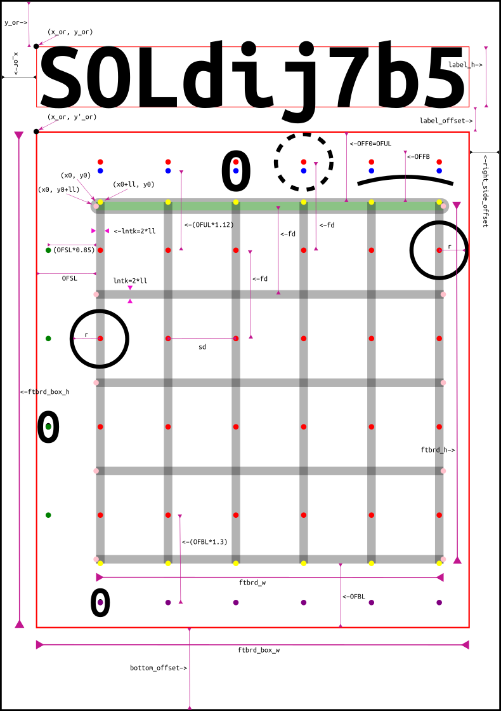
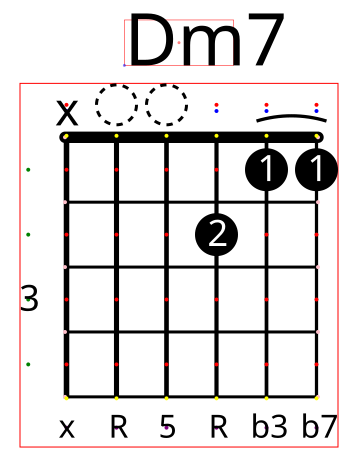

# How a chord image is built

This page explains, with a drawing, every size parameter of a chord diagram:
what it is, where it is in the image, its default value and how it changes
the result. All the values can be set in the `parameters` section of a
[config file](../README.md#config-file); the image adapts automatically.

<p>


</p>

*Left: the parameters on a chord diagram ([SVG source](./chord_geometry.svg), made with Inkscape).
Right: the same construction points drawn by fancychords itself in debug mode (see [See it yourself](#see-it-yourself)).*

The drawing shows every optional part at once, to have them all in one
picture: chord name on top, labels above the nut, a dot above the nut, a
barre, the fret number on the side and the footer. In a real chord some of
them exclude each other: for example with `--nut` an open string is drawn as
a dot, so only `x` (muted strings) can be written above the nut, never `0`.

All sizes are in SVG units (pixels when the image is shown at 100%).

## Contents

- [Colored points](#colored-points)
- [Input parameters](#input-parameters)
- [Computed sizes](#computed-sizes)
- [Room for the optional parts](#room-for-the-optional-parts)
- [Positions of grid, dots and labels](#positions-of-grid-dots-and-labels)
- [Chord name label](#chord-name-label)
- [Image size](#image-size)
- [Horizontal chords](#horizontal-chords)
- [Scales](#scales)
- [Tuning the look: examples](#tuning-the-look-examples)
- [See it yourself](#see-it-yourself)

## Colored points

The dots in the drawing are the points the program computes before drawing.
They are the same colors used by the debug mode:

| Color | Points |
|---|---|
| red | center of every possible note dot (`centers_matrix`), one row per fret; with `--nut` there is one more row above the nut |
| blue | centers of the labels above the nut (`x` or `0`) |
| green | centers of the fret numbers on the side |
| purple | centers of the footer labels |
| pink | ends of the horizontal (fret) lines |
| yellow | ends of the vertical (string) lines |
| red rectangle | the fretboard box (see `ftbrd_box_w`, `ftbrd_box_h`) |

## Input parameters

These are the values you can set in the `parameters` section of the config file.
Names in parentheses are the short names used in the drawing.

| Parameter | Meaning | Chords default | Scales default |
|---|---|---|---|
| `sd` | **string distance**: horizontal distance between two strings. It sets the overall size of the image | 50 | 55 |
| `fd` | **fret distance**: vertical distance between two frets | 65 (= `sd` × 1.30) | 77 (= `sd` × 1.40) |
| `lntk` | **line thickness** of the frets. Strings are drawn thicker on the bass side (from `lntk` × 1.85 on the 6th string down to about `lntk` × 1.08 on the 1st), the nut is `lntk` × 3.8 | 3 | 3 |
| `radius_factor` | dot radius as a fraction of `sd`: `r = sd × radius_factor` | 0.40 (`r` = 20) | 0.40 (`r` = 22) |
| `ns` | number of strings | 6 | 6 |
| `nf` | number of frets drawn. If a chord spans more frets, more are added automatically | 4 | 4 |
| `x_or` | left margin: distance of the drawing from the left border of the image (also used as right margin) | 20 | 20 |
| `y_or` | top margin: distance of the chord name from the top border (also used as bottom margin) | 20 | 20 |
| `barre_strk_wdth` | thickness of the barre arc | 3.3 (= `lntk` × 1.10) | – |

If the config file gives `sd` and `lntk` but not `fd`, `radius_factor` or
`barre_strk_wdth`, these are computed from `sd` and `lntk` with the
factors shown above, so the proportions stay the same.

Each dot can also be made bigger or smaller than `r` with the first value of
its [dot format](../README.md#dot-formats) (`dot size`, ie `0.9`).

## Computed sizes

From the input parameters the program computes (with the chord defaults):

| Name | Formula | Value | Meaning |
|---|---|---|---|
| `r` | `sd × radius_factor` | 20 | dot radius |
| `ll` | `lntk / 2` | 1.5 | half line thickness: lines are centered on their coordinates, so `ll` is used to align things to the line edges |
| `ftbrd_w` | `sd × (ns − 1) + lntk` | 253 | width of the grid, from the outer edge of the 6th string to the outer edge of the 1st |
| `ftbrd_h` | `fd × nf + lntk` | 263 | height of the grid, from the top edge of the nut line to the bottom edge of the last fret line |

## Room for the optional parts

Around the grid the program leaves room for the optional parts. The grid
plus this room is the **fretboard box** (the red rectangle).

| Name in code | In the drawing | Formula | Value | Room for |
|---|---|---|---|---|
| `offset_forfret0` | OFF0 | `fd / 2 + r` | 52.5 | dots above the nut (`--nut`) |
| `offset_upper_labels` | OFUL | same as OFF0 | 52.5 | `x` / `0` above the nut (on by default, `--no-header` to remove) |
| `offset_forbarre` | OFFB | `fd × 0.60` | 39 | the barre arc, when there is no other room above the grid |
| `offset_bottom_labels` | OFBL | `fd × 0.75` | 48.75 | footer labels (`--footer`) |
| `offset_side_labels` | OFSL | `r + sd × 0.50`, or just `r` with `--no-fretnumb` | 45 (20) | fret number on the side, and half a dot on the 6th string |

The room above the grid is **not** cumulative: it is the first that applies of

1. `offset_forfret0` if dots above the nut are drawn,
2. else `offset_upper_labels` if labels above the nut are drawn,
3. else `offset_forbarre` if barres are enabled,
4. else nothing.

The bigger room includes the smaller ones (the barre arc and the labels fit in
the room made for the dots above the nut). The footer room is added below
when the footer is on. So:

```text
ftbrd_box_w = ftbrd_w + r + offset_side_labels                 = 253 + 20 + 45 = 318
ftbrd_box_h = room above + ftbrd_h + (offset_bottom_labels if footer)
            = 52.5 + 263 + 48.75 = 364.25   (with --nut and --footer)
            = 52.5 + 263         = 315.5    (default options)
```

The `r` in `ftbrd_box_w` leaves room for half a dot on the 1st string (the
other half dot, on the 6th string, is inside `offset_side_labels`). The exact
width would be `ftbrd_w + r − ll + offset_side_labels`, but the program does not
subtract `ll`, so the border of the dots on the 1st string is never cut.

## Positions of grid, dots and labels

`(x_or, y'_or)` is the top left corner of the fretboard box. It is
`(x_or, y_or)` moved down by the chord name, when the name is on top
(see [Chord name label](#chord-name-label)):

```text
y'_or = y_or + label_h + label_offset
```

`(x0, y0)` is the top left corner of the grid:

```text
x0 = x_or  + offset_side_labels
y0 = y'_or + room above      (offset_forfret0, offset_upper_labels, offset_forbarre or 0, see above)
```

From there, with `i` = fret line (0 is the nut), `j` = string (0 is the 6th, low E),
`row` = fret, `col` = string:

| Points | Formula |
|---|---|
| fret lines (pink ends) | from `(x0, y0 + ll + i × fd)` to `(x0 + ftbrd_w, y0 + ll + i × fd)`, for `i` = 0 … `nf` |
| string lines (yellow ends) | from `(x0 + ll + j × sd, y0)` to `(x0 + ll + j × sd, y0 + ftbrd_h)`, for `j` = 0 … `ns − 1` |
| dot centers (red) | `(x0 + ll + col × sd, y0 + ll + fd / 2 + row × fd)`: on the string, in the middle of the fret |
| dots above the nut (red, top row, only with `--nut`) | the first row moved up by `fd`: `y − fd` |
| labels above the nut (blue) | above the first fret row by `offset_upper_labels × 1.12` |
| fret numbers (green) | left of the 6th string by `offset_side_labels × 0.85`, on each fret row |
| footer labels (purple) | below the last fret row by `offset_bottom_labels × 1.30` |
| barre arc | from the dot on the lowest to the dot on the highest string of the barre, `fd × 0.75` above the dot centers |

Label sizes follow the dot radius, so everything scales together:

| Label | Size | Config key to change it |
|---|---|---|
| inside the dots | fits the dot, smaller for longer labels | dot size in the dot format |
| above the nut | width `r × 1.15` | `upper_labels_font_factor` |
| footer | height `r × 1.00` | `bottom_labels_font_factor` |
| fret number | width `r × 0.90` (height, for 2 digit numbers) | `side_labels_font_factor` |

## Chord name label

| Name | Formula | Value |
|---|---|---|
| `label_h` | `fd × chord_label_font_factor` (twice that for a name on 2 lines) | 45.5 |
| `label_w` | width of the name written with height `label_h` | depends on the name |
| `label_offset` | `r × 0.90`: space between the name and the fretboard box | 18 |

If the name is wider than the fretboard box, `label_w` is reduced to
`ftbrd_box_w` and `label_h` is computed back from it, so a long name gets
smaller instead of going out of the image. The name is centered, or starts at
`x_or` with `chord_label_isleft`. With `--label_bottom` (`chord_label_isbottom`)
the name is drawn below the fretboard box and `y'_or` is just `y_or`.

The label size is estimated from fixed character proportions of each
supported monospace font, because an SVG file cannot measure text: with a
font that is not installed, the viewer uses another one and the name can look
a little bigger or smaller than planned.

## Image size

```text
image_w = x_or + ftbrd_box_w + right_side_offset                      = 20 + 318 + 20 = 358
image_h = y_or + label_h + label_offset + ftbrd_box_h + bottom_offset
        = 20 + 45.5 + 18 + 315.5 + 20 = 419   (default options)
```

where `right_side_offset = x_or` and `bottom_offset = y_or`, so the margins
are the same on both sides.

## Horizontal chords

With `--horizontal` the program computes everything as for a vertical chord
and then rotates all the points by 90 degrees (`rotate_shift_trasf` in
[libs/draw_fretbrd.py](../libs/draw_fretbrd.py)): the nut goes on the left,
the 6th string at the bottom, and `ftbrd_box_w` / `ftbrd_box_h` are swapped.
So the parameters keep the same meaning, only the directions change: `sd` is
now vertical and `fd` horizontal.

## Scales

Scales use the same geometry, with three differences:

- the fretboard has as many frets as the scale (or as the `padding` range), not 4;
- the defaults are a bit bigger (`sd` 55, `fd` = `sd` × 1.40, `r` 22) and the
  label factors are different (`scale_label_font_factor` 0.80, footer 0.80,
  fret numbers 0.70, and a single line name is 0.40 of the 2 lines size);
- fret numbers follow the guitar neck dots (3, 5, 7, 9, 12, 15, …) instead of a single number.

## Tuning the look: examples

All these go in the `parameters` section of a config file:

| You want | Change | Example |
|---|---|---|
| a bigger image, same proportions | `sd` only (and let `fd` and `radius_factor` be computed) | `"sd": 80.0` |
| longer frets (more vertical room for dots) | `fd` | `"fd": 80.0` |
| bigger dots | `radius_factor`. Dots on near strings are `sd` apart, so they touch when `2 × r = sd`, that is `radius_factor` = 0.5; keep it a bit lower to leave room for the dot borders | `"radius_factor": 0.44` |
| thinner lines | `lntk` (barre thickness follows if not given) | `"lntk": 2.0` |
| more empty space around | `x_or`, `y_or` | `"x_or": 40.0, "y_or": 40.0` |
| always 5 frets | `nf` | `"nf": 5` |

## See it yourself

Set `debug` to `true` in the `flags` section of a config file (like
[debug_config.json](./debug_config.json)) and every chord is drawn with the
construction points of the table above, the fretboard box and the label
boxes. The image on the top of this page was made, from this folder, with:

```bash
fancychords --cli_in="Dm7.debug|x,0,0,2,1,1|x,x,x,2,1,1|x,R,5,R,b3,b7|%|x,R,5,R,b3,b7" --config_file=./debug_config.json --nut --footer
```

The code that computes all these values is `get_basic_params()` and
`get_crd_params()` in [libs/draw_fretbrd.py](../libs/draw_fretbrd.py), and
`draw_chord()` in [libs/draw_chords.py](../libs/draw_chords.py).
